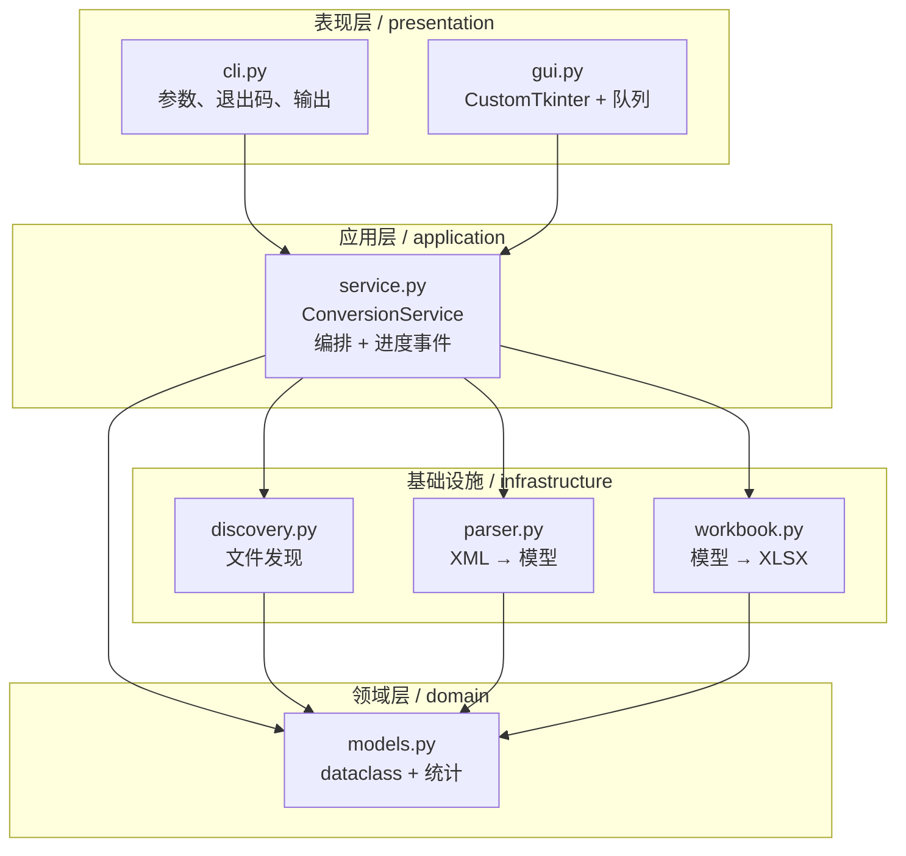

# 架构设计

## 分层

依赖方向单向向下：表现层不碰解析细节，解析层不含任何输出/打印逻辑，
`models.py` 不依赖 `xlsxwriter` 或 GUI 框架。因此 CLI 和 GUI 共用同一条
转换流水线，行为不会分叉。

## 数据流

1. `discover_xml_files()` 把输入规范化为排序、去重后的 `list[Path]`。
2. `ConversionService` 逐个调用 `NmapParser.parse()`，得到 `ScanResult`，
   聚合进 `ScanDataset`；单个文件的错误被记录为 `FileFailure` 而不中断整批。
3. `write_report()` 依据 `SHEETS` 声明生成 4 张工作表。
4. 返回 `ConversionOutcome`（含 `stats`、`failures`、`elapsed`），表现层决定
   如何展示以及退出码。

`Progress` 事件由服务层发出：`discover → parse(每文件一次) → write → done`。
回调运行在调用方线程里——GUI 的回调只往 `queue.Queue` 写消息，由主线程的
`after()` 轮询消费，从而避免跨线程操作 Tk 控件。

## 模块职责

| 模块 | 职责 | 不应包含 |
| --- | --- | --- |
| `models.py` | 数据结构、聚合、统计 | I/O、第三方库 |
| `discovery.py` | 输入校验、大小写无关匹配、递归、去重 | XML 解析 |
| `parser.py` | XML → dataclass、恶意实体声明拦截、键别名归一化 | 打印、emoji、Excel |
| `workbook.py` | 表定义、单元格写入、数值类型、注入防护 | 业务判断 |
| `service.py` | 编排、错误收集、计时、进度 | 具体 UI |
| `cli.py` / `gui.py` | 参数/事件、展示 | 解析与写文件逻辑 |
| `compat.py` | 1.x 门面（deprecated） | 新功能 |
| `exceptions.py` | 稳定的异常层次 | — |

## 关键设计决策

- **类型化的边界**：1.x 在层间传递 `dict[str, Any]`，`task_info` 有时是 dict
  有时是 list，导致单文件转换崩溃。现在只有 dataclass 能跨层传递。
- **表定义驱动**：`SheetSpec` / `Column` 声明一次，4 张表共享同一个写入循环。
  新增一列只需在声明里加一行。
- **数值列真实数字**：端口、主机数等写成 Excel number，可直接排序与统计。
- **不可信数据**：所有文本用 `write_string`，工作簿关闭公式与 URL 自动识别；
  超长文本按 Excel 的 32767 字符上限截断；允许 Nmap 标准 `<!DOCTYPE nmaprun>`，
  但拒绝 `<!ENTITY>` 声明与 DTD 内部子集，并限制文件大小。
- **可选 GUI**：`customtkinter` 只在 `[gui]` extra 中，`gui.py` 可在无该依赖的
  环境中被导入（类定义使用惰性基类），CLI / CI 不依赖桌面栈。
- **版本单一来源**：`__about__.__version__` 由 `pyproject.toml` 动态读取。

## 扩展点

- 增加报告列：改 `models.py` 的字段 → `parser.py` 填充 → `workbook.py` 的 `Column` 声明。
- 增加输出格式：新增 `writer.py`（如 CSV / JSON），在 `service.py` 中替换
  `write_report` 调用即可，`cli.py` 可加 `--format`。
- 增加扫描器支持：实现与 `NmapParser` 同接口的解析器，注入
  `ConversionService(parser=...)`。
